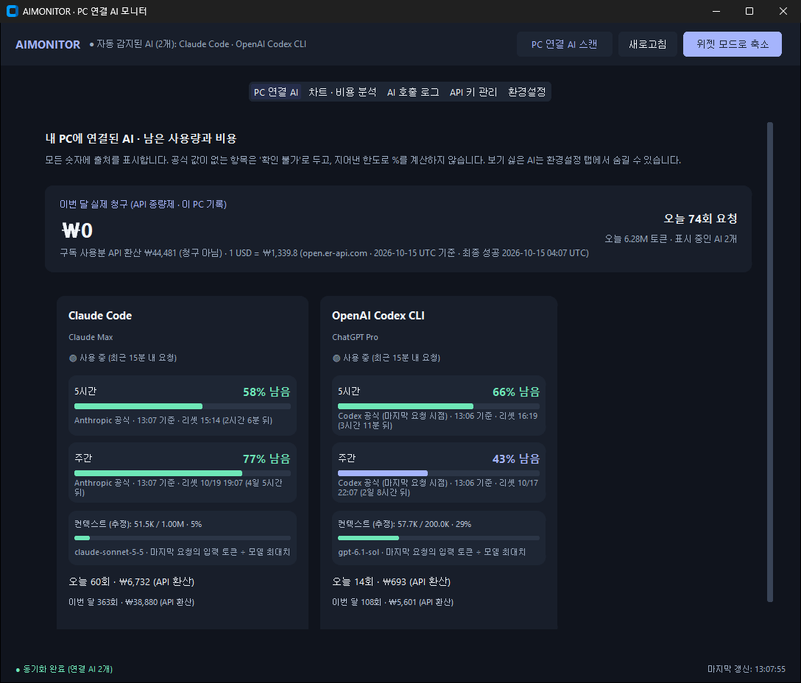
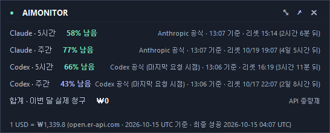

<h1 align="center">AIMONITOR</h1>

<p align="center">
  <b>Claude Code · Codex · Copilot의 남은 한도와 사용량을 Windows 트레이에서 한눈에.</b><br>
  계정 여러 개도 나눠서. 프롬프트·응답 본문은 모으지 않고.
</p>

<p align="center">
  <a href="https://github.com/supsuphansoup/AIMONITOR/actions/workflows/ci.yml"></a>
  <a href="https://github.com/supsuphansoup/AIMONITOR/releases/latest"></a>
  
  <a href="LICENSE"></a>
</p>

<p align="center"><b>한국어</b> · <a href="README.en.md">English</a></p>

<p align="center">
  <br>
  <br>
  <sub>메인 창과 항상 위 위젯. 화면의 숫자는 데모용 합성 데이터입니다.</sub>
</p>

## 이런 분께

- Claude Code의 **5시간·주간 한도가 얼마나 남았는지** 매번 `/usage`로 확인하기 번거로운 분
- **개인·회사 Claude 계정**이나 Codex·Copilot을 함께 써서 어디서 얼마나 썼는지 헷갈리는 분
- API 비용을 보고 싶지만 **프롬프트를 외부 SaaS에 넘기기는 싫은** 분

## 주요 기능

- **항상 위 위젯** — 도구별 남은 한도(%)와 리셋 시각, 오늘 사용량·비용을 화면 구석에. 트레이에서 숨기기·열기.
- **계정별 분리** — 여러 Claude·Codex 설정 폴더를 모두 읽고 계정마다 나눠 보여줍니다.
- **정직한 숫자** — 공식 값이 없으면 지어내지 않고 `확인 불가`·`계산 불가`. 추정치는 추정이라고 표시합니다.
- **메인 창** — 계정별 한도·사용량, 기록·차트(계정·모델별), 공급자 API 키와 공식 청구액·잔액, 표시·자동 실행 설정.
- **알림·CSV는 API로** — Slack/Discord 알림 규칙과 CSV 내보내기는 로컬 HTTP API로 씁니다. 메인 창에는 아직 설정 화면이 없습니다 ([알림 명세](docs/spec/alerts.md)).
- **내 앱의 LLM 호출도 함께** — Python SDK나 HTTP API로 OpenAI·Anthropic·Gemini·Ollama 호출을 같은 화면에서.
- **Windows 시작 시 자동 실행**.

| 도구 | 사용량 (토큰·비용) | 남은 한도 |
| :--- | :--- | :--- |
| Claude Code | ✅ | ✅ 5시간·주간 |
| OpenAI Codex | ✅ | ✅ 세션 로그의 한도 창 |
| GitHub Copilot | ✅ | ⚠️ 이번 달 프리미엄 요청 ÷ 직접 입력한 한도 (GitHub가 잔여량을 주지 않음) |
| Google Antigravity | ⚠️ 추정 | — |
| Cursor·Windsurf·Ollama | 연결 여부만 | — |

## 설치

**exe (권장, Python 필요 없음)**

1. [Releases](https://github.com/supsuphansoup/AIMONITOR/releases/latest)에서 `AIMONITOR-<버전>-windows-x64.zip`을 받아 원하는 폴더에 풉니다.
2. `AIMONITOR\AIMONITOR.exe`를 실행합니다.

코드 서명이 없어 처음 실행할 때 SmartScreen 경고가 뜰 수 있습니다. `추가 정보 → 실행`을 누르세요.
받은 파일은 함께 올린 `.sha256`으로 확인할 수 있습니다(`Get-FileHash <zip> -Algorithm SHA256`). 데이터는 `%USERPROFILE%\.aimonitor`에 저장됩니다.

**소스에서 실행** (Python 3.10+, Tkinter 포함)

```powershell
git clone https://github.com/supsuphansoup/AIMONITOR.git
cd AIMONITOR
pip install -r backend/requirements.txt -r desktop/requirements.txt
pythonw run_desktop.pyw
```

로컬 API 포트(기본 8000)를 다른 프로그램이 쓰고 있으면 앱에 `포트 충돌`이 표시됩니다. 그 프로그램을 끄거나
`%USERPROFILE%\.aimonitor\desktop_config.json`의 `backend_url` 포트를 바꾼 뒤 다시 실행하세요.

## 🔒 개인정보

다른 도구의 로그와 로그인 파일을 읽는 앱이라, 읽고 보내는 것을 모두 공개합니다 → **[전체 목록](docs/privacy.md)**

- 로컬 로그에서는 토큰·요청 수, 모델, 시각, 세션 ID와 계정 해시만 모읍니다. 프롬프트·응답 본문은 저장하거나 보내지 않습니다.
- 밖으로 보내는 곳: Claude 사용량 조회(`api.anthropic.com`, 비공식 엔드포인트), 환율 API, 등록한 키의 공급자, 설정한 Webhook. 텔레메트리는 없습니다.
- 공급자 API 키는 Windows DPAPI로 암호화합니다. 로컬 API는 `127.0.0.1`에서만 열립니다.

## 내 앱의 LLM 호출 기록하기

```python
from aimonitor import AIMonitor  # pip install -e sdk/python

monitor = AIMonitor(api_url="http://localhost:8000/api/v1")

@monitor.observe(provider="openai", model_name="gpt-4o")
def call_gpt(prompt: str):
    return openai_client.chat.completions.create(...)
```

지연·토큰·비용이 앱 화면에 함께 쌓입니다. SDK는 응답의 토큰 수만 읽고, 자동 오류 기록에는 예외 종류만 남깁니다. 비동기·배치 전송·캐시 토큰은 [SDK 문서](sdk/python/README.md), 데스크톱 없이 서버만 띄우는 방법(Docker)은 [운영 명세](docs/spec/security-ops.md), API 전체는 실행 중인 서버의 `/api/v1/docs`.

## 문서

| 문서 | 내용 |
| :--- | :--- |
| [docs/privacy.md](docs/privacy.md) | 읽는 파일·외부 전송·저장 위치 전체 |
| [docs/spec/](docs/spec/README.md) | 기능별 명세 — 데스크톱, 계정 수집, API 키, 수집·집계 API, 비용, 알림, 보안·운영 |
| [sdk/python/README.md](sdk/python/README.md) | Python SDK |
| [CHANGELOG.md](CHANGELOG.md) | 버전별 변경과 업그레이드 주의 |
| [CONTRIBUTING.md](CONTRIBUTING.md) | 개발 환경, 테스트, 기여 규칙 |
| [SECURITY.md](SECURITY.md) | 보안 취약점 제보 |

## 라이선스

[MIT](LICENSE). Windows 배포본에 함께 들어 있는 서드파티 구성요소는 각자의 라이선스를 따르며, 배포 폴더의 `THIRD_PARTY_NOTICES.txt`와 `licenses/`에 원문과 고지를 담았습니다.
