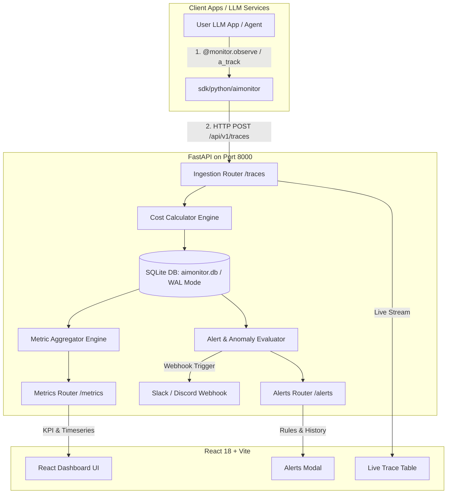

# 🗺️ Master Implementation Plan (`docs/PLAN.md`)

> **Project**: AIMONITOR  
> **Lead Coordinator**: Antigravity (Gemini)  
> **Worker**: GitHub Copilot Subagent  
> **Status**: ✅ **All Milestones (Phase 1 ~ Phase 4) 100% Completed & Verified**  

---

## 🏛️ System Architecture Overview

---

## 🎯 Tech Stack Blueprint

- **Backend**: Python 3.11+ / FastAPI, SQLModel (SQLite WAL Mode), Pydantic v2, PyTest
- **Frontend**: React 18, Vite, TypeScript, Lucide Icons, Recharts, Vanilla CSS Design System
- **SDK**: `sdk/python/aimonitor` (동기/비동기 데코레이터, 컨텍스트 매니저, `track()`, `a_track()`)
- **Container**: Multi-stage Docker (`node:22-alpine` builder + `python:3.11-slim` runtime) & `docker-compose.yml`

---

## 📅 Roadmap & Milestones (100% Complete)

### 📍 Phase 1: Core Engine & Data Models (기반 구축) — ✅ COMPLETED
- [x] `TASK-000`: AI 협업 체계 및 PRD/PLAN/AI 규칙 정의 (`AGENTS.md`, `.github/`, `docs/`)
- [x] `TASK-001`: 프로젝트 환경 초기화 및 디렉토리 스캐폴딩 (`backend/requirements.txt`, `main.py`)
- [x] `TASK-002`: 핵심 데이터 모델 & SQLite 스키마 정의 (`TraceEvent`, `AlertRule`, `AlertHistory`)
- [x] `TASK-003`: Ingestion API 엔드포인트 구현 (`POST /api/v1/traces`, 단건/배치 수신 및 트랜잭션 롤백)
- [x] `TASK-004`: LLM 모델별 비용 계산기 모듈 (`backend/app/services/cost.py`)

### 📍 Phase 2: Storage, Aggregation & Query API (분석 엔진) — ✅ COMPLETED
- [x] `TASK-005`: 시계열 메트릭 집계 엔진 (`backend/app/services/aggregator.py`, P50/P95/P99 산출)
- [x] `TASK-006`: 대시보드 조회 REST API 구현 (`/metrics/overview`, `/timeseries`, `/breakdown`)
- [x] `TASK-007`: Python Ingestion SDK 클라이언트 & 데코레이터 (`sdk/python/aimonitor/`)

### 📍 Phase 3: Real-time Web Dashboard (대시보드 UI) — ✅ COMPLETED
- [x] `TASK-008`: Frontend 스캐폴딩 (`frontend/package.json`, `vite.config.ts`, 다크 테마 `index.css`)
- [x] `TASK-009`: KPI 요약 카드 & 실시간 호출 로그 피드 (`KPICards.tsx`, `TraceTable.tsx`)
- [x] `TASK-010`: 레이턴시 및 토큰/비용 분석 시계열 차트 뷰 (`Charts.tsx`)
- [x] `TASK-011`: 필터링 및 상세 Trace 팝업 모달 (`TraceDetailModal.tsx`, ESC 지원)

### 📍 Phase 4: Alerting & Production Packaging (알림 및 배포) — ✅ COMPLETED
- [x] `TASK-012`: 이상 감지 & Webhook 알림 시스템 (`AlertEvaluator`, `AlertsModal.tsx`)
- [x] `TASK-013`: E2E 가상 트래픽 시뮬레이터 & 동시성 스트레스 테스트 (`scripts/simulate.py`, `test_stress.py`)
- [x] `TASK-014`: Docker & Docker-Compose 배포 패키징 (`Dockerfile`, `docker-compose.yml`)

---

## 🧪 Verification Matrix
- **Backend & SDK Tests**: **30 / 30 Passed (100%)**
- **Frontend Build**: TypeScript strict type check & Vite bundle **0 errors**
- **Stress & Concurrency**: 50 동시 요청 부하 테스트 100% 무결 통과
- **Deployment**: `docker compose up -d` 원클릭 단일 컨테이너 서빙 검증 완료
