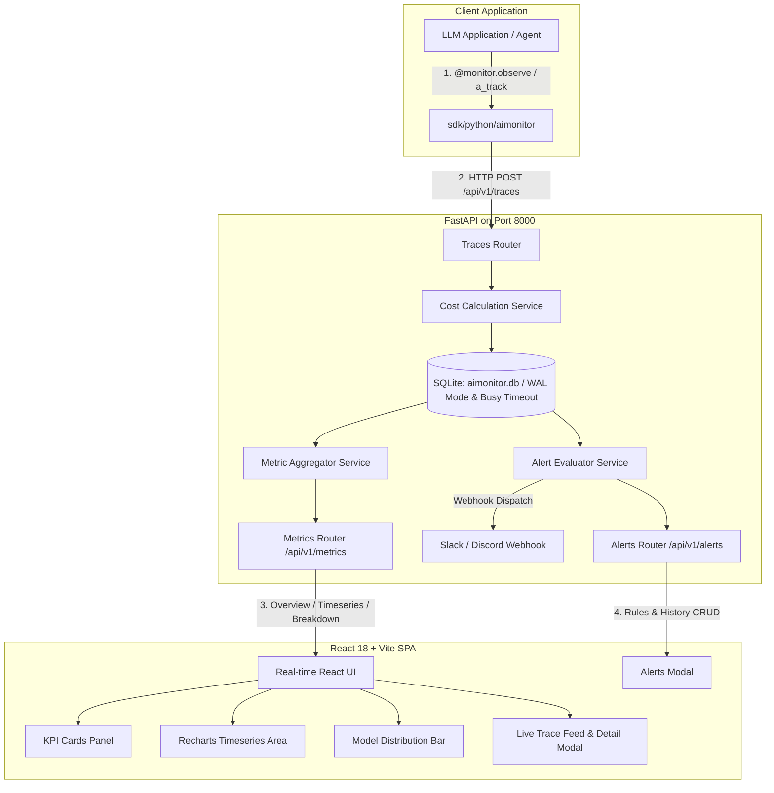

# 🏗️ AIMONITOR - System Architecture & Tech Spec

> **Coordinator**: Antigravity (Gemini)  
> **Status**: ✅ Active & Implemented  
> **Version**: v0.1.0  

---

## 1. 아키텍처 다이어그램 (Architecture Diagram)

---

## 2. 모듈별 역할 및 책임 (Module Responsibilities)

### 2.1 Backend (`backend/app/`)
- **`core/config.py`**: Pydantic BaseSettings 기반 환경 설정 (`DATABASE_URL`, `CORS_ORIGINS`, `API_V1_STR` 등).
- **`db/session.py`**: SQLite WAL(Write-Ahead Logging) 모드, `busy_timeout=15000` 설정으로 다중 스레드 동시 쓰기 락 원천 방어, Lifespan 기반 `engine.dispose()` 리소스 정리.
- **`models/trace.py`**: `TraceEvent` 시계열 엔티티 및 Ingestion DTO (`TraceEventCreate`, `BatchTraceCreate`, `TraceEventRead`).
- **`models/alert.py`**: 알림 규칙(`AlertRule`, `AlertRuleCreate`, `AlertRuleRead`) 및 발송 이력(`AlertHistory`, `AlertHistoryRead`) 엔티티.
- **`services/cost.py`**: OpenAI, Anthropic, Gemini, Ollama 모델별 최신 토큰 단가 테이블 및 음수 토큰 방어 비용 산출 엔진.
- **`services/aggregator.py`**: P50, P95, P99 지연 시간 산출, 5분/시간 단위 시계열 롤업, 모델별 점유율 집계 (안전한 UTC 타임존 변환).
- **`services/alert.py`**: `AlertEvaluator` 엔진을 통한 임계치 비교(`>`, `>=`, `<`, `<=`, `==`, `!=`), 히스토리 로깅 및 Slack/Discord Webhook 디스패처.
- **`routers/traces.py`**: Trace 단건/배치 수신(트랜잭션 롤백 보장), 페이징 및 필터링 검색 API.
- **`routers/metrics.py`**: 대시보드 KPI, 시계열 추이, 모델별 메트릭 제공 API.
- **`routers/alerts.py`**: 알림 규칙 CRUD, 발생 히스토리 조회, 수동 평가 트리거 API.
- **`main.py`**: FastAPI 메인 애플리케이션 및 프로덕션 React SPA 정적 번들(`frontend/dist`) 통합 서빙 마운트.

### 2.2 Frontend (`frontend/src/`)
- **`App.tsx`**: 5초 주기 자동 폴링 및 실시간 상태 동기화, 가상 트래픽 시뮬레이션 제어.
- **`components/KPICards.tsx`**: 총 호출수, P95/평균 지연시간, 누적 비용, 에러율 카드.
- **`components/Charts.tsx`**: Recharts 기반 반응형 시계열 지연시간 차트 및 모델별 비용/호출 분포 바 차트.
- **`components/TraceTable.tsx`**: 실시간 Trace 스트림 테이블 (Provider / Status 실시간 필터링, 에러 행 틴트 강조).
- **`components/TraceDetailModal.tsx`**: Trace 상세 페이로드, 프롬프트/완료 토큰 분해, 에러 로그 모달 (`Escape` 키 지원).
- **`components/AlertsModal.tsx`**: 알림 규칙 생성/삭제, 활성 규칙 리스트, 발생 히스토리 뷰어 및 수동 Evaluate 트리거.
- **`index.css`**: 현대적인 다크 테마 옵저버빌리티 콘솔 디자인 시스템.

### 2.3 Python Client SDK (`sdk/python/`)
- **`aimonitor/client.py`**: 
  - `@monitor.observe()`: 동기 및 비동기(`async def`) 함수 투명 지원 데코레이터.
  - `track()` / `a_track()`: 명시적 동기/비동기 트레이스 전송 API.
  - `with AIMonitor()`, `async with AIMonitor()`: Context Manager 지원으로 자동 연결 종료 및 리소스 누수 방지.
  - Graceful Fallback: 모니터링 수집 서버 장애 시에도 클라이언트 애플리케이션에 무영향.

### 2.4 Container & Deployment
- **`Dockerfile`**: Multi-stage 빌드 (Stage 1: `node:22-alpine` 프론트엔드 빌드 ➔ Stage 2: `python:3.11-slim` 런타임).
- **`docker-compose.yml`**: 포트 8000 단일 엔드포인트로 백엔드와 프론트엔드를 통합 서빙하는 원클릭 오케스트레이션.

---

## 3. 데이터베이스 스키마 명세 (Data Schema)

### `trace_events` 테이블
| 컬럼 | 타입 | 인덱스 | 설명 |
| :--- | :--- | :--- | :--- |
| `id` | INTEGER | PK | 고유 레코드 ID |
| `trace_id` | VARCHAR | YES | 유저 지정 또는 UUID 자동 발급 트레이스 ID |
| `session_id` | VARCHAR | YES | 세션/사용자 식별자 |
| `timestamp` | DATETIME | YES | 이벤트 발생 시각 (UTC) |
| `provider` | VARCHAR | YES | `openai`, `anthropic`, `gemini`, `ollama` 등 |
| `model_name` | VARCHAR | YES | 구체적인 모델명 (`gpt-4o`, `claude-3-5-sonnet` 등) |
| `prompt_tokens` | INTEGER | NO | 입력 토큰 수 (>= 0) |
| `completion_tokens`| INTEGER | NO | 출력 토큰 수 (>= 0) |
| `total_tokens` | INTEGER | NO | 전체 토큰 수 (>= 0) |
| `latency_ms` | FLOAT | NO | 응답 지연 시간 (밀리초, >= 0.0) |
| `cost_usd` | FLOAT | NO | 추정 발생 비용 (USD) |
| `status` | VARCHAR | YES | `SUCCESS`, `ERROR`, `TIMEOUT` |
| `error_message` | TEXT | NO | 에러 메시지 상세 |
| `tags` | VARCHAR | NO | 쉼표 구분 태그 목록 |
| `metadata_json` | TEXT | NO | 커스텀 메타데이터 JSON |

### `alert_rules` 테이블
| 컬럼 | 타입 | 인덱스 | 설명 |
| :--- | :--- | :--- | :--- |
| `id` | INTEGER | PK | 고유 규칙 ID |
| `name` | VARCHAR | YES | 알림 규칙명 |
| `metric_type` | VARCHAR | NO | `error_rate`, `latency_p95`, `total_cost` 등 |
| `operator` | VARCHAR | NO | `>`, `>=`, `<`, `<=`, `==`, `!=` |
| `threshold_value` | FLOAT | NO | 트리거 임계치 |
| `window_minutes` | INTEGER | NO | 롤링 윈도우 시간 (분) |
| `webhook_url` | VARCHAR | NO | Slack / Discord Webhook URL |
| `is_active` | BOOLEAN | YES | 활성 여부 |
| `created_at` | DATETIME | NO | 규칙 생성 시각 (UTC) |

### `alert_histories` 테이블
| 컬럼 | 타입 | 인덱스 | 설명 |
| :--- | :--- | :--- | :--- |
| `id` | INTEGER | PK | 고유 이력 ID |
| `rule_id` | INTEGER | YES | 참조 `alert_rules.id` |
| `rule_name` | VARCHAR | NO | 발동 당시 규칙명 |
| `triggered_value` | FLOAT | NO | 발동 당시 측정값 |
| `message` | TEXT | NO | 알림 상세 메시지 |
| `sent_successfully`| BOOLEAN | NO | Webhook 전송 성공 여부 |
| `created_at` | DATETIME | YES | 알림 발동 시각 (UTC) |
