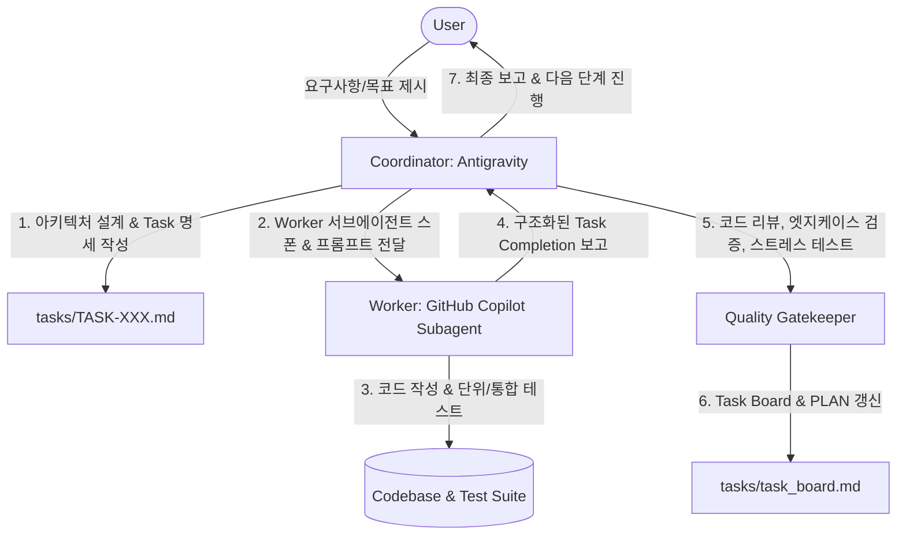

# 🤝 Coordinator-Worker Workflow Guide

이 문서는 **Coordinator(Antigravity)**와 **Worker(GitHub Copilot Subagent)** 간의 협업 거버넌스 및 워크플로우를 정의합니다.

---

## 📋 협업 4단계 워크플로우

### 1단계: 설계 및 작업 분할 (Coordinator)
- 사용자의 목표를 분석하여 전체 아키텍처(`docs/architecture.md`)와 로드맵(`docs/PLAN.md`)을 수립합니다.
- 작업을 독립적이고 검증 가능한 단위(`tasks/TASK-XXX.md`)로 분할합니다.
- `tasks/task_board.md`에 등록하고, Worker에게 전달할 정밀 프롬프트를 발급합니다.

### 2단계: 코드 구현 (Worker - GitHub Copilot)
- Worker AI(`worker_copilot`)는 `.github/copilot-instructions.md` 규칙에 따라:
  - 지정된 범위의 파일만 정확하게 작성/수정합니다.
  - 단위/통합 테스트 코드를 함께 작성하고 검증합니다.
  - 완료 요약(수정 파일, 테스트 결과, 이슈 사항)을 Coordinator에게 보고합니다.

### 3단계: 품질 게이트 검수 (Coordinator)
- Coordinator(Antigravity)가 생성된 코드를 확인하고:
  - 아키텍처 정합성, 타입 안전성 및 엣지 케이스를 심층 리뷰합니다.
  - 전수 린트, 정적 컴파일, 동시성 부하 테스트를 직접 실행하여 무결성을 검증합니다.
  - 결함 발견 시 수정-재검증 루프를 수행하여 결함 0건을 확보합니다.

### 4단계: 상태 업데이트 & 릴리스
- `tasks/task_board.md` 및 `docs/PLAN.md`의 진행 상황을 `Done`으로 갱신하고 최종 산출물을 정리합니다.

---

## 💡 Worker AI (Copilot) 행동 규약 요약
1. **지정된 범위 준수**: `tasks/TASK-*.md`에 명시된 파일과 요구사항만 수정/생성.
2. **프로덕션 퀄리티**: TODO 빈 함수, Dummy Mock 남발 금지, 완결된 형태의 typed 코드 작성.
3. **단위 테스트 필수**: 모든 신규 모듈에 대해 100% 동작 가능한 단위 테스트 작성 및 통과 검증.
